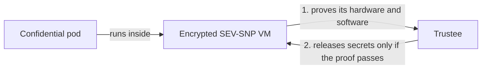

# OpenShift Confidential Containers on AMD SEV-SNP

This repository builds a disconnected single-node OpenShift cluster on AMD
SEV-SNP bare metal, installs confidential containers (CoCo) on it and proves that
their security controls work.

A confidential container runs inside its own hardware-encrypted VM. The VM gets no
secrets, not even the credentials to pull its own image, until it proves to
Trustee that it runs the approved software on genuine AMD hardware.



## Status

| | |
|---|---|
| Release | OpenShift 4.20.39, OSC 1.13.1, Trustee 1.2.1 (exact pins in the [release manifest](install/release-manifest.json)) |
| Last full run | October 29, 2026, on new Cherry Servers hardware, following these docs only. Every test passed twice, with a reset between. See [validation results](docs/validation.md). |
| Live environment | None. Each run orders its own servers and deletes them at the end. |

**Proven on the test rig:** Trustee releases secrets only to a VM whose hardware,
launch measurement and configuration (initdata) match the approved values; the VM
runs only signed images; and neither the node, an ordinary pod nor a confidential
VM can reach the internet.

**Not proven:** encrypted images, Trustee in a separate cluster (the customer
layout), Trustee in Restricted HTTPS mode, upgrades of an existing deployment, and
a fully private boot from power-on.

## Choose your path

| I want to | Start here |
|---|---|
| **Run it**: order a rig, install, test, delete | [Quickstart](docs/quickstart.md) (about 3 hours and 4 EUR of server time) |
| **Maintain it**: rerun the tests, reset the lab, refresh certificates, move to new versions | [Maintenance](docs/maintenance.md) |
| **Share it**: explain it, demo it, hand it over, change it | [Share this repository](docs/sharing.md) |

Every guide is listed in the [documentation index](docs/README.md).

## The whole run

```bash
source scripts/env.sh                      # 1. set up this controller
make order-rig                             # 2. order the AMD node and the helper
                                           # 3. switch on SEV-SNP in the node's BIOS (by hand)
bash ansible/up.sh --mode fresh-install    # 4. install OpenShift (erases the node's disk)
make connect && source scripts/env.sh
make install-coco-operators                # 5. install the CoCo Operators
make trustee-lab && source scripts/env.sh  # 6. set up Trustee
make test-rung WHICH=all                   # 7. prove the security controls
terraform -chdir=infra/cherry destroy -var-file="$COCO_STATE_DIR/cherry.tfvars"   # 8. delete the rig
```

The [quickstart](docs/quickstart.md) explains each step, what it asks and how long
it takes. When something fails, see [troubleshooting](docs/troubleshooting.md).

## What you need

- A Linux controller (your workstation) with Bash, Python 3.12+, `curl`, `jq`,
  `make`, OpenSSH, Terraform 1.9+ and Podman.
- A [Cherry Servers](https://portal.cherryservers.com/) account with an empty
  project and an API key. The automation orders an AMD EPYC node and a helper
  server there. Another provider needs changes to the ordering, discovery and
  reinstall steps.
- An SSH key pair and your Red Hat
  [pull secret](https://console.redhat.com/openshift/install/pull-secret).

Without hardware, `make lint` runs every offline check and `make help` lists all
commands.

## Repository layout

| Directory | Contents |
|---|---|
| [`docs/`](docs/README.md) | The guides and the dated validation results |
| [`install/`](install/README.md) | Release manifest (exact versions and digests) and the oc-mirror image set |
| [`infra/cherry/`](infra/cherry/README.md) | Terraform that orders the node and the helper |
| [`ansible/`](ansible/README.md) | Helper preparation and the OpenShift install |
| [`gitops/`](gitops/README.md) | Manifests for the Operators, Kata runtime, Trustee and test workloads |
| [`scripts/`](scripts/README.md) | Install steps, Trustee setup, image signing and the test runner |
| [`tests/`](tests/README.md) | Offline regression tests (no cluster or hardware needed) |

## Secrets stay outside the checkout

Pull secrets, SSH keys, kubeconfigs, signing keys and test evidence live in
`COCO_STATE_DIR`, by default `~/.local/state/openshift-confidential-containers`.
The scripts refuse to write them inside the checkout.

## Glossary

| Term | Meaning |
|---|---|
| **CoCo** | Confidential containers: pods that run inside a hardware-encrypted VM. |
| **OSC** | OpenShift sandboxed containers, the Red Hat Operator that installs Kata and CoCo. |
| **Kata, `kata-cc`, `kata-snp`** | Kata Containers runs each pod in a VM. `kata-cc` is the RuntimeClass for confidential pods; on AMD it must use the `kata-snp` handler. |
| **SEV-SNP** | AMD Secure Encrypted Virtualization with Secure Nested Paging, the hardware feature that encrypts and isolates the VM. |
| **Trustee, KBS** | Trustee checks the VM's attestation evidence. Its Key Broker Service (KBS) releases secrets only to VMs that pass. |
| **Attestation** | The VM proving to Trustee what hardware and software it is running. |
| **VCEK** | The AMD certificate for one specific chip. Trustee needs it to check that node's evidence offline. |
| **RVPS, reference values** | The approved launch measurement and firmware levels that Trustee compares the evidence against. |
| **initdata** | Configuration handed to the VM at launch (Trustee URL, certificates, policies). Its hash is measured, so any change is detectable. |
| **SNO** | Single-node OpenShift. |
| **Rig** | The pair of servers (helper and AMD node) used for one run. |
| **Helper, bastion** | The server that hosts the mirror registry, DNS, NTP and boot files. Both names appear in the code. |
| **Controller** | The Linux machine you run everything from. |
| **Rung** | The code's name for one capability test, for example `rung-kbs` or `rung-signed`. |
| **Lab** | The test rig's layout: Trustee on the same cluster as the workloads, in the Permissive profile (`TRUSTEE_LAB=1`). Not a customer layout. |
