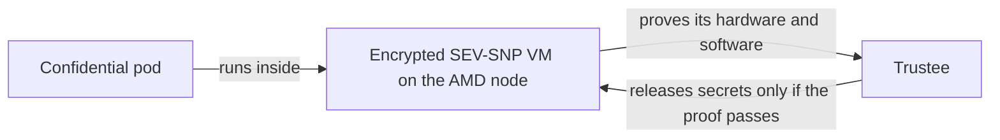

# OpenShift Confidential Containers on AMD SEV-SNP

This repository installs and tests **confidential containers (CoCo)** on a
single-node OpenShift cluster running on AMD SEV-SNP bare metal, in a
disconnected (air-gapped) network. A confidential container runs inside its own
small, hardware-encrypted VM. Before the VM receives any secrets, it must prove
to a separate service (Trustee) that it is running the expected software on
genuine AMD hardware.



The [architecture overview](docs/architecture.md) shows the full exchange.

The repository gives you:

- Ansible automation that turns two supplied bare-metal servers (a helper and an
  AMD node) into a disconnected single-node OpenShift cluster.
- Scripts and manifests that install OpenShift sandboxed containers (OSC), the
  Red Hat build of Trustee, and the supporting Operators.
- A test runner that proves the security controls work: each test runs a
  workload that should succeed, changes one thing, checks that the change is
  rejected, then restores and checks recovery.

## Current status

| | |
|---|---|
| Validated release | OpenShift 4.20.39, OSC 1.13.1, Trustee 1.2.1 (exact pins in the [release manifest](install/release-manifest.json)) |
| Last hardware validation | October 8, 2026, on Cherry Servers (AMD EPYC 9124). See [validation results](docs/validation.md). |
| Live environment | None. The test servers were deleted after validation. You need new hardware to run anything beyond the offline checks. |

What passed: offline attestation, secret release, measured-initdata and
launch-reference enforcement, signed-image verification and network isolation,
both on the first install and after removing and reinstalling the CoCo software.

What has **not** been validated: encrypted container images, a Trustee running
in a separate cluster (the customer layout), Restricted HTTPS mode for Trustee,
upgrades of an existing deployment, and fully private boot from power-on.

## What you need

- **A Linux controller** (your workstation or a jump host) with Bash, Python 3.12+,
  `jq`, SSH, Ansible and Terraform. Everything is driven from here.
- **Two bare-metal servers on the same private VLAN**:
  - an AMD EPYC node with SEV-SNP support and UEFI boot (this becomes OpenShift), and
  - a helper running RHEL 9 (it hosts the mirror registry, DNS and NTP; the trial
    used AlmaLinux 9, which Red Hat does not support for the mirror registry).
- **Console access to the AMD node's BIOS** to turn on SEV-SNP.
- **A Red Hat pull secret** with access to OpenShift and the OSC/Trustee Operators.

The automation was built and tested against Cherry Servers. Another provider
will need changes to the discovery and reinstall steps in
[`ansible/`](ansible/README.md).

## How to run it

Follow these guides in order. Each one ends where the next begins.

1. **[Order the rig](docs/quickstart.md#2-order-the-rig)**: `source scripts/env.sh`
   sets up the controller, and `make order-rig` orders the node and the helper on
   Cherry Servers, starts the helper's mirror registry and writes your rig file.
2. **[Set the BIOS](docs/quickstart.md#3-set-the-bios)**: switch on SEV-SNP in the
   node's console.
3. **[Install OpenShift and the CoCo Operators](docs/quickstart.md#4-install-openshift)**:
   `bash ansible/up.sh --mode fresh-install` checks the node, asks once before it
   erases it, then prepares the helper and installs the node. `make connect` reaches
   the cluster, and `make install-coco-operators` adds the Operators after one approval.
4. **[Set up Trustee](docs/trustee.md#disposable-lab)**: `make trustee-lab`
   collects the node's AMD certificate, calculates the reference values, asks you
   to approve them once and publishes the attestation policies. On the lab it also
   gives the confidential VM access to the private registry; elsewhere,
   [configure guest image pulls](docs/guest-images.md) yourself.
5. **[Run the capability tests](docs/capability-status.md)**: `make test-rung WHICH=all`
   proves that each security control allows the right workload and denies a
   tampered one, then checks network isolation.

When something fails, see [troubleshooting](docs/troubleshooting.md). The
[documentation index](docs/README.md) lists every guide, and the
[architecture overview](docs/architecture.md) has diagrams of the components.

### Checks you can run without hardware

```bash
make help           # list every command
make check-release  # check the release files agree with each other
make preflight      # also require every image and tool to be pinned
make proof-plan     # list the capability tests
make lint           # run all offline checks (see docs/contributing.md for tools)
```

## Repository layout

| Directory | Contents |
|---|---|
| [`install/`](install/README.md) | Release manifest (exact versions and digests) and the oc-mirror image set |
| [`infra/cherry/`](infra/cherry/README.md) | Terraform that orders the node and the helper on Cherry Servers |
| [`ansible/`](ansible/README.md) | Helper preparation and OpenShift installation |
| [`gitops/`](gitops/README.md) | Kustomize manifests for the Operators, Kata runtime, Trustee and test workloads |
| [`scripts/`](scripts/README.md) | Install steps, Trustee configuration, image signing and the test runner |
| [`tests/`](tests/README.md) | Offline regression tests (no cluster or hardware needed) |
| [`docs/`](docs/README.md) | Guides and the dated validation results |

## Keep secrets out of the checkout

Pull secrets, SSH keys, kubeconfigs, signing keys and test evidence must live
outside this directory. The scripts refuse to write them inside the checkout.
By default they use:

```text
$HOME/.local/state/openshift-confidential-containers
```

Set `COCO_STATE_DIR` to use a different location.

## Glossary

| Term | Meaning |
|---|---|
| **CoCo** | Confidential containers: pods that run inside a hardware-encrypted VM. |
| **OSC** | OpenShift sandboxed containers, the Red Hat Operator that installs Kata and CoCo. |
| **Kata, `kata-cc`, `kata-snp`** | Kata Containers runs each pod in a VM. `kata-cc` is the RuntimeClass for confidential pods; it must use the `kata-snp` handler on AMD. |
| **SEV-SNP** | AMD Secure Encrypted Virtualization with Secure Nested Paging, the hardware feature that encrypts and isolates the VM. |
| **Trustee, KBS** | Trustee checks the VM's attestation evidence. Its Key Broker Service (KBS) releases secrets only to VMs that pass. |
| **Attestation** | The VM proving to Trustee what hardware and software it is running. |
| **VCEK** | The AMD certificate for one specific chip. Trustee needs it to check that node's evidence offline. |
| **RVPS, reference values** | The approved launch measurements and firmware levels that Trustee compares the evidence against. |
| **initdata** | Configuration handed to the VM at launch (Trustee URL, certificates, policies). Its hash is measured, so any change is detectable. |
| **SNO** | Single-node OpenShift. |
| **Rig** | The pair of servers (helper and AMD node) used for one install. |
| **Helper, bastion** | The server that hosts the mirror registry, DNS, NTP and boot files. Both names appear in the code. |
| **Controller** | The Linux machine you run Ansible and the scripts from. |
| **Rung** | The code's name for one capability test, for example `rung-kbs` or `rung-signed`. |
| **Disposable lab** | A test cluster where Trustee runs on the same cluster as the workloads in Permissive mode (`TRUSTEE_LAB=1`). Not a customer layout. |
