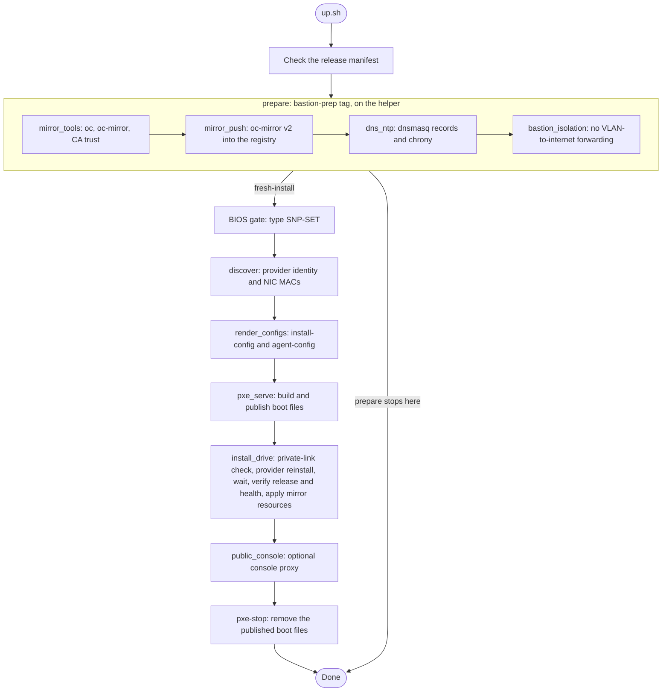

# Ansible workflow

Ansible prepares a helper server you were given and installs single-node
OpenShift on a disposable AMD node. Allocating the servers and setting the BIOS
are manual. Start with the [quickstart](../docs/quickstart.md) and
[Cherry Servers setup](../docs/cherry-servers.md).

Copy [`rig.example.yml`](rig.example.yml) outside the checkout to describe your
servers, and pass it with `-e "@$COCO_STATE_DIR/rig.yml"`. Defaults for everything
else are in [`group_vars/all.yml`](group_vars/all.yml). The
[mirror bootstrap](bootstrap/mirror-registry.yaml.j2) is a cloud-init template that
sets up the helper's network and mirror registry before Ansible runs;
[Cherry Servers setup](../docs/cherry-servers.md#render-the-helper-bootstrap) shows how to render it.

## Modes

`ansible/up.sh` wraps `ansible-playbook playbooks/site.yml` and selects tags for you.

| Command | Behavior |
|---|---|
| `bash ansible/up.sh --mode prepare` | Default: prepare tools, mirror, DNS and NTP on the helper. Does not touch the node |
| `--mode fresh-install` | Prepare, check the node's hardware and private network, then **erase the node** and install OpenShift |
| `--mode resume-install` | Finish an install the provider already accepted, with unchanged inputs; sends no new reinstall |
| `--mode verify` | Check the installed OpenShift version and health without reinstalling |

`resume-install` runs only the `install_drive` step and `pxe-stop`; `verify` runs
only the release and health checks in `install_drive`.

## Tags

| Tag | Responsibility |
|---|---|
| `bastion-prep` | Checked tools, mirror transfer, DNS/NTP and helper isolation |
| `bios`, `discover` | Explicit BIOS acknowledgement and the node's actual provider and NIC identity |
| `render`, `pxe` | Installer configuration and boot files tied to the current inputs |
| `drive` | Journaled reinstall request, install wait, exact release, health and mirror-resource checks |
| `pxe-stop` | Remove published boot files and their nginx configuration |

## State and safety

- Discovery writes validated NIC bindings to `discovery/node-macs.json` under
  `COCO_STATE_DIR` and discards them if a check fails. Recheck after reprovisioning.
- Installer sources and assets stay private under `/opt/install` on the helper;
  nginx gets separate copies under `/var/www/coco-boot-artifacts`. Do not loosen
  the private permissions to make publication work.
- The reinstall request is journaled under `/opt/install/provider-requests`,
  outside the replaceable assets, so an interrupted run can resume without a
  second reinstall. See [troubleshooting](../docs/troubleshooting.md) for
  ambiguous requests and cleanup.
- Keep credentials, boot tokens, kubeconfigs and recovery files outside the checkout.
- `public_console_enabled` defaults to on (an `sslip.io` console name on the
  helper's public IP); set it to `false` when you don't need it.
- The `machines` list can render several hosts, but only single-node installs
  have been validated. [Validation results](../docs/validation.md) define the scope.
