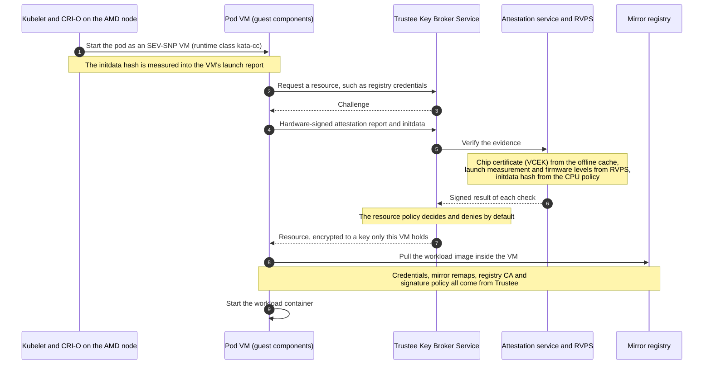
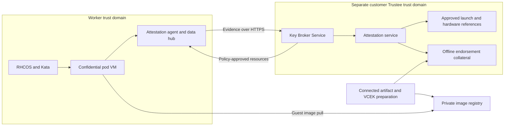
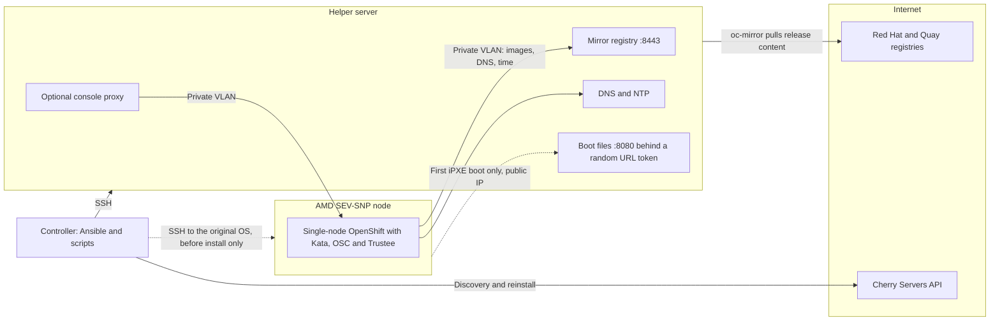
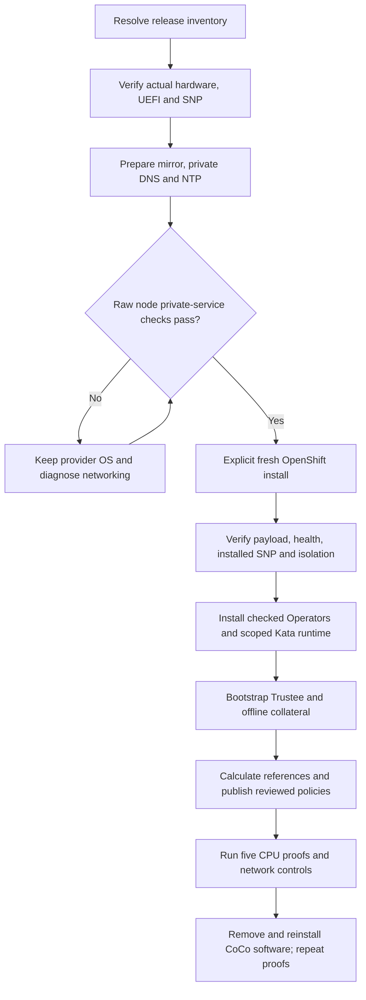
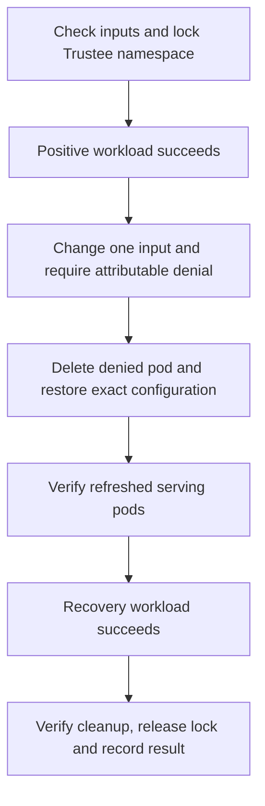

# Architecture

A confidential pod runs inside its own small VM on the AMD node. SEV-SNP encrypts
that VM's memory so the host cannot read it. The VM starts without its secrets:
it has to prove to Trustee what hardware and software it is running before
Trustee releases anything, including the credentials it needs to pull its own
container image. This page shows that exchange, the components involved, the
test rig the automation builds, and the order of the install and the tests.

## How a confidential pod gets its secrets

Each [capability test](capability-status.md) changes one input in this exchange
(the initdata, a reference value, the image signature or the VCEK) and checks
that Trustee then refuses the request.

## Components and trust domains

`WORKER_CONTEXT` and `TRUSTEE_CONTEXT` select the two domains independently, so
the scripts can drive a worker cluster and a separate Trustee cluster. `kata-cc`
must resolve to the `kata-snp` handler. The completed trial used a simpler
layout: Trustee on the same cluster in the Permissive profile over HTTP. The
separate customer boundary drawn here has not been validated on hardware; see
[validation results](validation.md).

## The test rig

The node and the helper share a private VLAN (`192.168.66.0/24` by default, set in
[`ansible/group_vars/all.yml`](../ansible/group_vars/all.yml)). The node's bonded
network has no public address once OpenShift is installed: it reaches only the
helper's registry, DNS and NTP. The helper keeps its public interface to stage
content and serve the first boot, but does not forward traffic from the VLAN to
the internet. The cluster API is only on the VLAN, so the controller reaches it
through the helper (for example, an SSH tunnel). The optional `gitops/base/airgap-egress`
MachineConfig adds a host egress filter on the node.

## Install sequence

A fresh install replaces the node's operating system; it is not an upgrade path
for an existing cluster. A successful install also stops serving the boot files.
The [quickstart](quickstart.md) walks through these steps, and
[the Ansible README](../ansible/README.md) shows which playbook phase does what.

## Capability test sequence

A denial only counts when Trustee logs a matching, specific refusal for that VM.
Unrelated errors (DNS, registry, a missing image) and skipped steps cannot pass.
If restoring the configuration fails, the runner keeps the recovery files and the
lock so you can inspect them. [Capability tests](capability-status.md) define each
negative control; [customer planning](customer-planning.md) covers deployment and
upgrade decisions.
