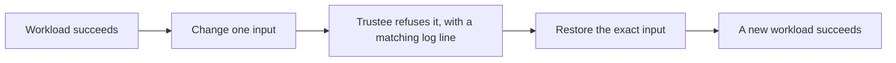

# Capability tests

A healthy cluster does not show that the confidential-container controls work.
These tests do. All six passed twice on [October 29, 2026](validation.md).

## What each test proves

Each test starts a workload that must succeed, changes one input, requires
Trustee to refuse the changed workload, restores the input and requires a new
workload to succeed again.



| Test | The change | A pass shows |
|---|---|---|
| `rung-kbs` | Run the workload in an ordinary pod, without the confidential VM | Its secret is released only inside the confidential runtime (this is not an attack on Trustee's authentication) |
| `rung-initdata` | Add a harmless comment to the VM's measured initdata | Changed configuration is refused, with the CPU and firmware checks still on |
| `rung-rvps` | Remove the approved launch measurement from Trustee | Launch-measurement enforcement, separately from initdata |
| `rung-signed` | Pull an unsigned copy of the image under the same key policy | The VM enforces image signatures |
| `air-gap` | Replace the node's AMD certificate (VCEK) in Trustee with a wrong one | Trustee checks the hardware evidence against the node's own certificate, offline |
| `isolation` | None: it probes egress at three layers | No public address or name is reachable from the node, an ordinary pod or a confidential VM, and `oc exec` into the VM is refused |
| `rung-encrypted` | Change initdata for an encrypted image | Experimental and **not validated**; `WHICH=all` skips it |

A denial only counts when Trustee logs a matching refusal for that VM. DNS or
registry errors, a missing image and skipped steps never count as a pass.

## Run them on the lab

After [`make trustee-lab`](trustee.md#disposable-lab):

```bash
source scripts/env.sh
make proof-plan              # list the tests; * marks the ones WHICH=all runs
make test-rung WHICH=all     # about 25 minutes
make test-rung WHICH=rung-signed   # or one test
```

The run stops at the first test that does not pass. Exit code `0` is PASS, `1`
FAIL and `3` INCOMPLETE. Each test pod prints PodSecurity `restricted` warnings and
a warning about the `node-role.kubernetes.io/master` selector; both are expected
on a single-node cluster.

Each run writes `$COCO_STATE_DIR/proofs/<run>/results.json`, with the release
identities, policy hashes, pod UIDs and each control's result, plus the recovery
files. Tests never reuse an earlier result, and they do not reset or reinstall
anything; [maintenance](maintenance.md) covers that.

If restoring an input fails, the runner keeps the recovery files and a lock on the
Trustee namespace so nothing else changes it. Inspect the recovery files and the
actual resources before removing the lock.

## Network isolation

At each layer a private destination must answer first, so a blocked result
cannot come from a broken probe. Then a public address (`1.1.1.1`) and a public
name (`quay.io`) must both fail.

| Layer | How it probes | Private destination |
|---|---|---|
| Node | `oc debug node/$PROOF_NODE` | The mirror registry's `/v2/` (answers `401`) |
| Ordinary pod | A short-lived pod in the workload namespace | The in-cluster Trustee service |
| Confidential VM | A `rung-kbs` workload whose application runs the probes and reports through its exit code, since the agent policy blocks `oc logs` | The in-cluster Trustee service |

Then it runs `oc exec` into another confidential workload, which the agent policy
must refuse with `ExecProcessRequest is blocked by policy`. Repeat it after every
reboot or rollout with `make test-rung WHICH=isolation`.

## Run them outside the lab

First complete [Trustee setup](trustee.md) and [guest registry access](guest-images.md)
by hand. The runner then needs:

- `COCO_DISPOSABLE_TEST=1` and explicit worker and Trustee contexts.
- The workload and Trustee namespaces labeled `coco.openshift.io/disposable=true`,
  only after you confirm both belong to this test.
- The pinned worker payload, successful OSC and Trustee CSVs, the endpoint and
  mirror CAs, and the reviewed agent policy.

```bash
oc --context="$WORKER_CONTEXT" create namespace coco-validation
oc --context="$WORKER_CONTEXT" label namespace coco-validation coco.openshift.io/disposable=true
oc --context="$TRUSTEE_CONTEXT" label namespace trustee-operator-system coco.openshift.io/disposable=true

export WORKER_CONTEXT=validation-workers TRUSTEE_CONTEXT=validation-trustee
export COCO_DISPOSABLE_TEST=1 TRUSTEE_PROFILE=Restricted TRUSTEE_LAB=0
export KBS_URL=https://trustee.example.internal
export KBS_CA_FILE="$COCO_STATE_DIR/trustee-ca.pem"
export MIRROR_CA="$COCO_STATE_DIR/mirror-ca.pem"
export AGENT_POLICY_FILE="$COCO_STATE_DIR/approved-agent-policy.rego"
make test-rung WHICH=rung-kbs WORKLOAD_NS=coco-validation NS=trustee-operator-system
```

`WORKLOAD_NS` selects the workloads and `NS` selects Trustee. For `air-gap`, also
set `PROOF_NODE` and that worker's `VCEK_SECRET_NAME`, derived from its HWID so it
matches the KbsConfig cache entry. `INITDATA_FILE` reuses approved initdata bytes,
and `EMIT_INITDATA=1` prints the bytes the renderer would use. Initdata is visible
in the pod annotation: put certificates and resource references in it, never
secret values. The agent policy must allow the workload and deny administrator
`ExecProcessRequest`.

## Signed images

On the lab, `make trustee-lab` builds these. Elsewhere, build them on a machine
with Skopeo and Cosign that reaches the registry by the name the VM uses, because
the signature records that name:

```bash
SSL_CERT_FILE="$MIRROR_CA" skopeo login -u init --password-stdin mirror.rig.local:8443 < "$MIRROR_PASSWORD_FILE"
SSL_CERT_FILE="$MIRROR_CA" cosign login -u init --password-stdin mirror.rig.local:8443 < "$MIRROR_PASSWORD_FILE"
read -rs COSIGN_PASSWORD && export COSIGN_PASSWORD   # waits silently for a new key password
SSL_CERT_FILE="$MIRROR_CA" make build-rung-signed
source "$COCO_STATE_DIR/rung-image-artifacts/rung-signed.env"
```

The first build creates the signing key pair in `$COCO_STATE_DIR/rung-image-artifacts`.
It pushes `coco/rung-b` (signed) and `coco/rung-b-unsigned`, then checks that the
signed image verifies and the unsigned one is rejected
(`make verify-rung-signed-signature` repeats that). Both can show the same image
digest: the signature is stored per repository. Publish the image policy and
signing key through [Trustee setup](trustee.md), then run
`make test-rung WHICH=rung-signed`. A host `cosign verify` is only preparation;
the test is what proves the VM enforces it.

## Encrypted images

Not validated. The tested OpenShift 4.20.39 CRI-O lacks the VM image-service change
from [OpenShift CRI-O PR 82](https://github.com/openshift/cri-o/pull/82), and an
end-to-end test also needs a matching OSC release and key-provider setup.
`EXPERIMENTAL_ENCRYPTED_IMAGES=1` allows the experiment when it is named
explicitly; it never joins `WHICH=all`.
