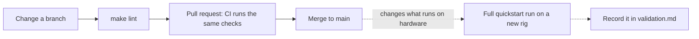

# Contributing



The offline checks catch most mistakes, but they cannot test firmware or
attestation. A change to what runs on the hardware is only proven by a new full
[quickstart](quickstart.md) run: record it in [validation results](validation.md)
and, for a new server plan, in [`tested-plans.json`](../infra/cherry/tested-plans.json).

## Set up the checks

Use Python 3.12+ and a virtual environment outside the checkout. Linux is the
provisioning controller; CI also checks the portable workstation scripts on macOS.

```bash
umask 077
export COCO_STATE_DIR="$HOME/.local/state/openshift-confidential-containers"
mkdir -p "$COCO_STATE_DIR"
python3 -m venv "$COCO_STATE_DIR/dev-venv"
source "$COCO_STATE_DIR/dev-venv/bin/activate"
python3 -m pip install -r requirements-dev.txt
make install-dev-tools
export PATH="$COCO_STATE_DIR/dev-bin:$PATH"
make lint
```

Install ShellCheck separately through your operating system's package manager.
`make install-dev-tools` fetches checksum-verified OPA/Kustomize. `make lint` runs
shell, policy, manifest, documentation-link and offline regression checks; the
[tests README](../tests/README.md) explains what the unit tests cover.
Local checks do not validate firmware or attestation.

For documentation-only edits, run `python3 scripts/check-doc-links.py` and
`git diff --check`. Keep commands aligned with `make help`, link to a guide rather
than copying its steps, and keep the date and scope on every validation claim.
If you change a Mermaid diagram, `python3 scripts/check-mermaid.py` renders every
diagram (it needs Node.js 22+; set `PUPPETEER_EXECUTABLE_PATH` to use an installed
Chrome or Chromium).

## Continuous integration

`.github/workflows/offline-validation.yml` runs `scripts/lint.sh` on every pull
request and push to `main`: on Linux with Python 3.12 and 3.14, and on macOS with
Python 3.12. The macOS job puts `/bin/bash`, the Bash 3.2 that macOS ships, first
on `PATH`, so every script and the tests that run them use it, as on a
workstation. Each job takes about four minutes. A separate job
renders every Mermaid diagram, and another formats, validates and tests the
[Cherry Servers Terraform](../infra/cherry/) offline with a mocked provider
(`terraform -chdir=infra/cherry init -backend=false && terraform -chdir=infra/cherry test`
runs the same locally). Dependabot proposes monthly updates for the pinned GitHub
Actions, Python development requirements and Terraform provider; the OPA and Kustomize pins in
`scripts/install-dev-tools.py` and the product pins in the
[release manifest](../install/release-manifest.json) are updated by hand (see
[release resolution](release-resolution.md)).

## Where commands run

| Location | Work |
|---|---|
| Linux controller | Ansible, release resolution and orchestration |
| Linux helper | Mirror, DNS/NTP, boot publication and artifact preparation |
| macOS or Linux workstation | Portable cluster/workload scripts with explicit contexts and required external inputs |
| AMD node / RHCOS | Host SNP check and commands invoked through node debug |

macOS's Bash 3.2 is supported for the portable script paths. Install the required
`oc`, `jq`, Python 3.12+, Skopeo/Cosign and Podman only for the operations you use.
Host-side hashing/base64 goes through `scripts/lib/compat.sh`; node-side GNU commands
run on Linux. Use Linux for provisioning even when driving portable scripts from macOS.
