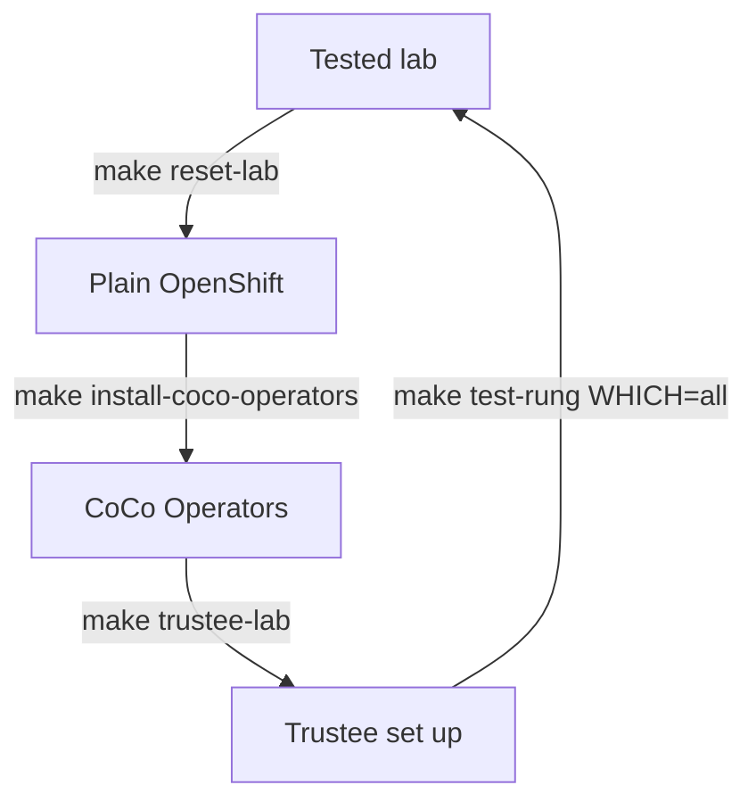

# Maintenance

Everything here assumes a terminal where you ran `source scripts/env.sh` after
[`make connect`](quickstart.md#5-install-the-coco-operators), on the rig you mean
to change. These helpers are for test rigs; they are not a production backup or
upgrade service.

| Task | Command | Details |
|---|---|---|
| Reach the cluster again (after a controller restart) | `make connect` | [Quickstart step 5](quickstart.md#5-install-the-coco-operators) |
| Rerun the tests | `make test-rung WHICH=all` | [Capability tests](capability-status.md) |
| Put the lab back to plain OpenShift | `make reset-lab` | [Below](#reset-a-disposable-coco-lab) |
| Refresh a node's certificate after a firmware change | `make collect-vcek`, `make seed-vcek` | [Below](#collateral-and-references) |
| Publish changed policies or references | `scripts/apply-trustee.sh configure` | [Below](#configuration-refresh) |
| Move to newer OpenShift, OSC or Trustee | | [Release resolution](release-resolution.md) |
| Delete the rig | `terraform -chdir=infra/cherry destroy ...` | [Below](#retire-the-infrastructure) |

## Reset a disposable CoCo lab



`make reset-lab` removes the CoCo Operators, Trustee, the test workloads and the
Kata runtime. It keeps OpenShift, the mirror, the servers and `$COCO_STATE_DIR`,
including the signing key pair. Copy any proof reports you want to keep first.

```bash
make reset-lab
```

It shows the cluster, the node and every namespace it deletes, and asks you to
type `reset`; without a terminal, use `ALLOW_DISPOSABLE_UNINSTALL=1 make reset-lab`.
Then it removes the stack, waits until everything is gone and checks the cluster,
in about 10 minutes. The node reboots when the Kata runtime goes, so a watch error
while the API is down is expected, and `Waiting:` lines are normal; `FAIL:` only
appears on a timeout. If it stops, inspect finalizers before retrying; do not
clear them blindly.

To test again from scratch, run quickstart steps
[5](quickstart.md#5-install-the-coco-operators) to
[7](quickstart.md#7-run-the-capability-tests): `make install-coco-operators`,
`make trustee-lab`, `source scripts/env.sh`, `make test-rung WHICH=all`.

`make reset-lab` only runs on the lab (`TRUSTEE_LAB=1`, one context for workloads
and Trustee, as `lab.env` sets). On any other cluster, use `make uninstall-coco`:
it removes only namespaces that already carry the `coco.openshift.io/disposable=true`
label, so label only namespaces the test owns.

## Collateral and references

Recollect a node's VCEK after a firmware or TCB change, or on a new server: an
unchanged chip ID alone does not mean an older certificate still matches.

```bash
make collect-vcek NODE='<worker-node>'
make seed-vcek
```

On a disconnected controller, run `scripts/collect-vcek.sh --download` on a
connected machine and carry the bundle back (`--from-report <file>` takes a raw SNP
report). `VCEK_BUNDLE` selects the bundle path. Bootstrap or configure Trustee
afterwards so the new certificate is mounted. Collection does not renew anything
on its own; check expiry before reuse.

Recalculate the launch measurement after any change to the guest image, release or
kernel command line, and rebind initdata after any byte change, including policy
or certificate changes. Then rerun the affected tests. On the lab,
`make trustee-lab` does all of this; elsewhere follow [Trustee setup](trustee.md#by-hand).
Reference values expire on purpose; extending one needs a new review.

## Configuration refresh

`scripts/apply-trustee.sh configure` publishes approved policy, reference and
resource changes and waits until Trustee serves them. After applying a CPU policy
ConfigMap yourself, refresh Trustee:

```bash
python3 scripts/refresh-trustee.py --context "$TRUSTEE_CONTEXT" \
  --namespace trustee-operator-system --trustee-name trustee-config
```

It replaces the Operator-owned pods and checks their new UIDs and mounts.
Changing a ConfigMap or running `oc rollout restart` alone does not prove that
Trustee serves it. Rotating TLS or signing keys and pruning resources need their
own reviewed procedure.

## Retire the infrastructure

Copy anything you want to keep (proof reports in `$COCO_STATE_DIR/proofs`,
evidence) before you delete the servers; the cluster and the mirror go with them.
If you ordered with `make order-rig`, Terraform deletes exactly the servers it
created, and the SSH key if it added one; a key your account already had stays.

```bash
terraform -chdir=infra/cherry destroy -var-file="$COCO_STATE_DIR/cherry.tfvars"
```

Type `yes` when the plan lists the two servers (a script adds `-auto-approve`
instead). Then check in the Cherry portal or API that the project has no servers
left: a power-off or a failed SSH login does not prove deletion.

Last, stop the `make connect` tunnel to the deleted helper:
`pgrep -af '^ssh .*-L 127.0.0.1:6443'` shows its process ID, and `kill <ID>`
stops it.
