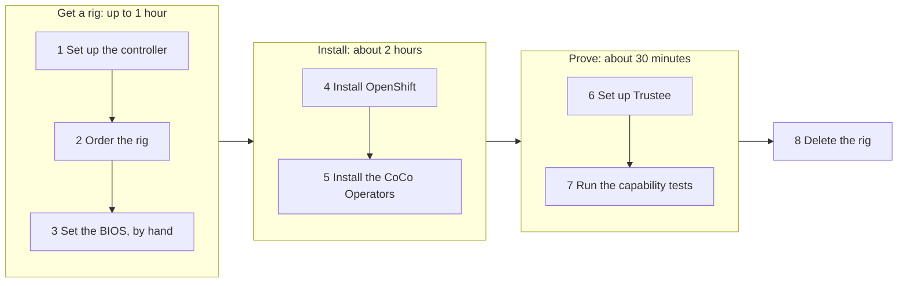

# Quickstart: one full run

This guide takes you from nothing to a tested confidential-containers cluster and
back to nothing. It orders two Cherry Servers machines, turns them into a
single-node OpenShift cluster, installs CoCo, proves its security controls and
deletes the servers.

It is for a **disposable test rig**: step 4 erases the AMD node's disk. For an
existing customer cluster, read [customer planning](customer-planning.md) instead.



The whole run takes about three hours (times from the [October 29 run](validation.md)),
and the tested rig costs about 1.25 EUR per hour while it exists. Step 3 is the
only manual step; steps 2, 4, 5, 6 and 8 each ask you to confirm once. Every step
can be rerun if it stops.

## Before you start

- [ ] A Linux machine to run everything from (the controller), with Bash, Python
      3.12 or later, `curl`, `jq`, `make`, OpenSSH,
      [Terraform](https://developer.hashicorp.com/terraform/install) 1.9 or later
      and [Podman](https://podman.io/).
- [ ] A [Cherry Servers](https://portal.cherryservers.com/) account with an empty
      project and an [API key](https://portal.cherryservers.com/settings/api-keys).
- [ ] An SSH key pair for both servers.
- [ ] Your Red Hat [pull secret](https://console.redhat.com/openshift/install/pull-secret),
      saved as a file.

## 1. Set up the controller

From the root of this checkout, in every new terminal:

```bash
source scripts/env.sh
```

The first time, it builds the controller in `COCO_STATE_DIR` (by default
`~/.local/state/openshift-confidential-containers`, outside the checkout): a
Python environment and the pinned `oc` and `openshift-install`, checked against
their published hashes. It checks that the release files agree, then asks once
for your Cherry Servers API key and keeps it in `$COCO_STATE_DIR/cherry-api-key`,
readable only by you. Later runs take a second and also load the cluster settings
that steps 5 and 6 write.

## 2. Order the rig

```bash
make order-rig
```

It asks its questions first: which rig (the tested plans in stock, cheapest
first, with their hourly price), which project, which SSH key and where your pull
secret is. It orders nothing until you type `yes`. Then it runs on its own,
mostly waiting for Cherry to deliver the servers:

- It orders the AMD node and the helper with the [Terraform in `infra/cherry`](../infra/cherry/).
- It pins both servers' SSH host keys in `$COCO_STATE_DIR/known_hosts`.
- It starts the helper's mirror registry.
- It checks the node's private VLAN, network bond and disks. A new node
  sometimes boots with one bond member missing; it offers the one reboot that
  fixes it.
- It writes `$COCO_STATE_DIR/rig.yml`, the file every later step reads.

Delivery usually takes 15 to 30 minutes and sometimes over an hour. If it stops,
fix what it reports and run it again: it skips the stages that are done and takes
over a server that Cherry was still delivering instead of ordering another.
[Cherry Servers setup](cherry-servers.md) explains what it chooses and how to
order something else.

> [!IMPORTANT]
> Step 4 erases the disk that `node_root_device` in the rig file names: the disk
> that holds the original OS's `/boot/efi`. The file's comments list its serial
> and the other disks. To install on another disk, change that line.

## 3. Set the BIOS

A new node's BIOS usually has SEV-SNP switched off. Switch it on through the
node's browser console, as [Set the BIOS](cherry-servers.md#set-the-bios) shows.
You can do this while `make order-rig` waits for the mirror; it says when. Then
check the node without changing anything:

```bash
make check-node-snp
```

It prints the board, BIOS version, boot mode and install disk, and a `PASS` or
`FAIL` line for each SEV-SNP check. The output is saved in `$COCO_STATE_DIR/evidence`.

To save half an hour, run `bash ansible/up.sh` in another terminal once
`make order-rig` has finished, while you are still in the BIOS. It prepares the
helper without touching the node, and step 4 reuses what it prepared.

## 4. Install OpenShift

> [!WARNING]
> This step **erases the AMD node's install disk** and installs OpenShift on it.

```bash
bash ansible/up.sh --mode fresh-install
```

First it checks the node again (server identity, UEFI boot, SEV-SNP, install
disk) and asks you to type the node's server ID. Nothing has changed up to that
point, and nothing more is asked after it. Then it:

1. Prepares the helper: pinned tools, the release images mirrored into its
   registry, and private DNS and NTP for the node (about 30 minutes).
2. Builds the installer configuration and boot files from the node's network identity.
3. Checks from the node's original OS that it reaches the helper's registry, DNS
   and NTP over the private VLAN, and stops before erasing anything if it does not.
4. Asks Cherry to reinstall the node from the helper's boot files and waits for
   the install: 45 to 70 minutes. To follow it, run
   `sudo tail -f /opt/install/cluster-assets/.openshift_install.log` on the helper.
5. Checks the OpenShift version and health, applies the mirror configuration and
   stops serving the boot files.

If the controller stops after Cherry accepted the reinstall (a closed laptop, a
restart), do not start over. The install carries on without it; pick it up with:

```bash
bash ansible/up.sh --mode resume-install
```

Without a terminal, answer the question ahead with `-e confirm_erase=<server ID>`;
the checks still run. `bash ansible/up.sh --mode verify` repeats the version and
health checks later without reinstalling.

The install also publishes the OpenShift web console through the helper, at
`https://console-openshift-console.apps.sno-coco.<helper public IP>.sslip.io`, with
a self-signed certificate. Log in as `kubeadmin`; the password is in
`/opt/install/cluster-assets/auth/kubeadmin-password` on the helper. Add
`-e public_console_enabled=false` to keep it private.

## 5. Install the CoCo Operators

```bash
make connect
source scripts/env.sh
make install-coco-operators
```

The cluster API is only on the private VLAN. `make connect` copies the cluster's
kubeconfig from the helper, opens an SSH tunnel to the API through the helper,
checks the cluster and writes `$COCO_STATE_DIR/lab.env`, which `source scripts/env.sh`
loads in every terminal. The tunnel keeps running after the terminal closes; if
`oc` cannot reach the cluster later, run `make connect` again.

`make install-coco-operators` creates the Operator Subscriptions, checks every
InstallPlan against the [release manifest](../install/release-manifest.json),
shows them and asks you to type `yes`. Then it waits for the Kata runtime to roll
out: the node reboots and the API stops answering for a few minutes. It takes
about 20 minutes. Without a terminal, approve ahead with
`APPROVE_INSTALLPLANS=1 make install-coco-operators`; plans that do not match the
manifest are refused either way.

## 6. Set up Trustee

```bash
make trustee-lab
source scripts/env.sh
```

It collects the node's AMD certificate (VCEK), calculates the reference values a
correct VM must report, builds and signs the test images, and publishes the
policies and resources to Trustee, in about 3 minutes. It shows the reference
values and asks you to type `yes`; without a terminal, use
`APPROVE_REFERENCES=1 make trustee-lab`. Its settings go to
`$COCO_STATE_DIR/trustee-lab.env`, which `source scripts/env.sh` loads.
[Trustee setup](trustee.md#disposable-lab) explains each step.

## 7. Run the capability tests

```bash
make test-rung WHICH=all
```

A healthy cluster does not show that the controls work; these tests do. Each one
starts a workload that must succeed, changes one input, checks that Trustee
refuses it, restores the input and checks that a new workload succeeds again.
The run takes about 25 minutes, ends with `Proof run PASS` and writes a report to
`$COCO_STATE_DIR/proofs/`. [Capability tests](capability-status.md) explains what
each test proves.

## 8. Delete the rig

Billing runs until the servers are gone. Delete them:

```bash
terraform -chdir=infra/cherry destroy -var-file="$COCO_STATE_DIR/cherry.tfvars"
```

Type `yes` when the plan lists the two servers, then check in the Cherry portal
that the project is empty. [Retire the infrastructure](maintenance.md#retire-the-infrastructure)
also covers the leftover tunnel.

To keep the cluster for a demo or a second round instead, see
[maintenance](maintenance.md): `make reset-lab` puts it back to plain OpenShift
for a clean reinstall of CoCo.
