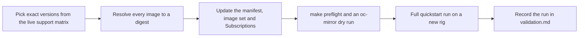

# Move to new product versions

The [release manifest](../install/release-manifest.json) pins every version and
image digest the automation installs. It was resolved with authenticated registry
access on October 5, 2026, and the [hardware runs](validation.md) tested exactly
that set.

As of October 20, 2026, OSC 1.13.1 and Trustee 1.2.1 were the newest releases.
OpenShift 4.20 had newer z-streams (4.20.42), but 4.20.39 stays selected until
someone repeats this process and a full hardware run.



Resolving reads registries and writes evidence outside the checkout. It does not
approve an upgrade or validate hardware; only the full run does.

## Tools

A connected Linux controller with Python and PyYAML, `jq`, the pinned `oc` and
oc-mirror v2, [Skopeo](https://github.com/containers/skopeo/blob/main/install.md)
and [opm](https://docs.redhat.com/en/documentation/openshift_container_platform/4.20/html/cli_tools/opm-cli).
Verify downloaded binaries against their published checksums.

Set `AUTH_FILE` to your pull secret and `OUT` to a new evidence directory, both
outside the checkout. Never print or hash the credential file into shared evidence.

## Select and verify

1. Check the live OSC compatibility matrix, Operator lifecycle and entitlements,
   and the OpenShift update graph. Choose exact versions; a channel head is not
   an upgrade proof.
2. Fetch the catalog's **raw** manifest with Skopeo, compute its digest and fetch
   again by that digest; the bytes must agree. Keep the top-level index pin, and
   check the Linux/AMD64 child for rendering.
3. Render only the pinned catalog with opm and validate it. Confirm the package,
   channel, CSV and version for each Operator.
4. Render each pinned bundle and compare its CSV, version, dependencies and related
   images with the catalog. Decode bundle objects before comparing; the two
   representations differ.
5. Resolve every related, helper and diagnostic image the same way, and check its
   architecture.
6. Add every required dependency explicitly: oc-mirror v2 does not infer them.

A basic registry check:

```bash
skopeo inspect --authfile "$AUTH_FILE" --tls-verify=true --raw \
  "docker://<selected-image-ref>" > "$OUT/manifest.json"
skopeo manifest-digest "$OUT/manifest.json"
```

Do not reserialize JSON before hashing. The tested opm build read credentials only
from `DOCKER_CONFIG/config.json`, not `REGISTRY_AUTH_FILE`: point that config at
your auth file, then run `opm render <pinned-amd64-catalog> -o json` and
`opm validate <catalog-directory>`. See the
[file-based catalog schema](https://olm.operatorframework.io/docs/reference/file-based-catalogs/)
and [oc-mirror v2 filtering](https://docs.redhat.com/en/documentation/openshift_container_platform/4.20/html/disconnected_environments/about-installing-oc-mirror-v2).

## Update the matching files

| File | Keep aligned |
|---|---|
| `install/release-manifest.json` | Platform, catalog, bundle and image pins, package, channel, CSV and version, dependencies, evidence date. `tools.mirrorRegistry` pins the mirror-registry archive: a versioned URL from <https://mirror.openshift.com/pub/cgw/mirror-registry/> and the SHA-256 from that version's signed `sha256sum.txt` |
| `install/imageset-config.yaml` | The same catalog and helper images, exact Operator version ranges, dependencies and default channels |
| `gitops/base/operators/subscriptions.yaml` | The same package, channel, source and `startingCSV`; keep Manual approval |
| `gitops/base/gatekeeper/operator.yaml` | The same Gatekeeper selection and Manual approval |

Stage the candidate manifest and image set in `$OUT`, then check them:

```bash
IMAGESET_CONFIG="$OUT/imageset-config.resolved.yaml" \
  python3 scripts/verify-release.py \
  --manifest "$OUT/release-manifest.resolved.json" --require-resolved
(
  cd "$OUT"
  env -u REGISTRY_AUTH_FILE oc mirror --authfile "$AUTH_FILE" \
    --cache-dir "$OUT/mirror-cache" -c "$OUT/imageset-config.resolved.yaml" \
    "file://$OUT/mirror-preview" --dry-run --v2
)
```

The verifier reads the Subscriptions from the checkout. The tested oc-mirror build
needs `REGISTRY_AUTH_FILE` unset and a destination not literally named `dry-run`.
Inspect the planned mapping for every source; a dry run does not prove mirroring.

Mark `resolution: verified` only after these checks pass, and confirm the
Gatekeeper entitlement separately. Copy the files into the checkout, run
`make preflight`, then do a full [quickstart](quickstart.md) run on a new rig and
add it to [validation results](validation.md).
