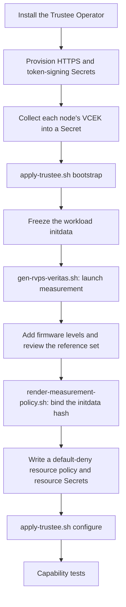

# Trustee setup

This workflow uses Trustee 1.2.1 on AMD SEV-SNP. Customer defaults are
**Restricted, HTTPS and a separate trust domain**. The completed
[lab proofs](validation.md) used co-located Permissive HTTP with enforcing
resource policy; they do not validate the customer topology.

Use Python 3.12+, the development requirements, `jq` and the selected `oc`.
Set `TRUSTEE_CONTEXT` explicitly. Keep credentials and generated files in external
`COCO_STATE_DIR` storage as described in the [quickstart](quickstart.md).

Trustee decides whether a confidential VM gets its secrets (see
[the attestation sequence](architecture.md#how-a-confidential-pod-gets-its-secrets)).
Setting it up means giving it three things: the AMD certificate for each approved
node (VCEK), the measurements a correct VM must report (reference values), and the
policies that say which resources a passing VM may receive. The steps below run
in this order:



## Bootstrap

Install the selected Trustee Operator on the intended cluster. Provision the namespace
and these Secrets through the customer's credential/certificate process:

- `kbs-https-cert`: endpoint TLS certificate/key (`tls.crt`, `tls.key`).
- `kbs-token-cert`: attestation token signing/trust certificate/key.
- VCEK Secrets for the approved workers. [Collection and refresh](maintenance.md#collateral-and-references)
  use current host/TCB evidence; collection does not publish Secrets automatically.

The TLS names can be overridden with `TRUSTEE_HTTPS_SECRET` and
`TRUSTEE_TOKEN_SECRET`. Rerunning bootstrap does not rotate these identities.

Collect each approved worker's VCEK, then publish the collected certificates as
Secrets. The collector names each worker's directory under
`$COCO_STATE_DIR/vcek-bundle` after its HWID (the chip ID, 128 lowercase hex
digits), and bootstrap needs those identities in `HWIDS`:

```bash
export TRUSTEE_CONTEXT=customer-trustee TRUSTEE_PROFILE=Restricted TRUSTEE_LAB=0 TEE=snp
make collect-vcek NODE='<worker-node>'   # uses WORKER_CONTEXT
make seed-vcek                           # uses TRUSTEE_CONTEXT
export HWIDS="$(ls "$COCO_STATE_DIR/vcek-bundle" | grep -E '^[0-9a-f]{128}$' | tr '\n' ' ')"
```

If the controller can't reach AMD's key server, collection stops after recording
the certificate URL. Run `scripts/collect-vcek.sh --download` on a connected
machine and copy the bundle back before `make seed-vcek`. Then bootstrap:

```bash
make preflight
scripts/apply-trustee.sh bootstrap
```

Use `RENDER_ONLY=1` to inspect TrusteeConfig without a cluster action. Bootstrap
waits for Operator-owned KbsConfig/ConfigMaps and migration markers, checks their
ownership, and selects SNP `OfflineStore`. It retains the cache path and existing
resource entries but attaches no new customer workload resources.

An independent older KbsConfig stops the workflow. This is a fresh bootstrap,
not an automatic Trustee 1.1 upgrade. See [customer planning](customer-planning.md)
before migrating an existing deployment. Do not delete configuration or set migration
markers by hand to bypass that check.

## Calculate the approved references

Freeze the exact workload initdata bytes, including the complete reviewed agent
policy. For the capability tests, the renderer prints the bytes the test workloads
use (set the same profile, CA and policy variables you will test with):

```bash
EMIT_INITDATA=1 make -s run-rung-kbs > "$COCO_STATE_DIR/initdata.toml"
```

Then generate launch references from the selected release artifacts:

```bash
PULL_SECRET="$COCO_STATE_DIR/credentials/pull-secret.json" \
  INITDATA="$COCO_STATE_DIR/initdata.toml" \
  OUT="$COCO_STATE_DIR/rvps-generated.yaml" \
  VERITAS_KERNEL_CMDLINE='<exact reviewed runtime command line>' \
  scripts/gen-rvps-veritas.sh
```

The tested coco-tools default omitted `agent.launch_process_timeout=6`, which was
present in the actual Kata launch string. Supply the reviewed full string; the
independently calculated launch value must match the verified guest quote.
Read the string from a running confidential VM, not from the Kata configuration
file, because the runtime adds parameters at launch. With any `kata-cc` pod
running on the worker (it doesn't need to attest), print its QEMU `-append` argument:

```bash
oc --context="$WORKER_CONTEXT" debug node/'<worker-node>' -- chroot /host sh -c \
  'for p in $(pgrep -f qemu); do tr "\0" "\n" < /proc/$p/cmdline | grep -A1 -x -- -append | tail -n 1; done'
```
Reference generation can need connected registry access; stage its results before isolation.

Review the output and build the **complete** approved reference set:

- Trustee 1.2 `reference_value` maps names to base64-encoded JSON records with
  `name`, UTC-seconds `expiration` and typed `value`. Malformed, duplicate or expired
  records are rejected.
- Add `snp_bootloader`, `snp_microcode`, `snp_snp_svn` and `snp_tee_svn` as lists of
  integers (the CPU policy checks them with `in`) for the approved platforms. The
  generator does not collect hardware TCB. Each collected VCEK was requested for the
  node's reported TCB, so its URL carries the four values; `scripts/review-references.py`
  adds them from the bundle for every HWID in `HWIDS` and prints the result for review.
- Omit coco-tools 0.5.1's unused SHA-384 `init_data` record when binding SHA-256 initdata
  through the CPU-policy extension below (`--drop init_data`).

```bash
scripts/review-references.py "$COCO_STATE_DIR/rvps-generated.yaml" \
  "$COCO_STATE_DIR/rvps-reviewed.yaml" --drop init_data
```

Generating or observing a value does not approve it. Confirm its source, expected
platform and expiry before publication.

## Bind initdata and publish resource policy

The default CPU policy does not bind the complete initdata digest. Render the
extension from the actual vendor CPU policy and the generated ConfigMap name found
in `KbsConfig.spec.kbsAttestationPolicyConfigMapName`:

```bash
CPU_CM="$(oc --context="$TRUSTEE_CONTEXT" -n trustee-operator-system get kbsconfig \
  -o jsonpath='{.items[0].spec.kbsAttestationPolicyConfigMapName}')"
oc --context="$TRUSTEE_CONTEXT" -n trustee-operator-system get configmap "$CPU_CM" \
  -o jsonpath='{.data.default_cpu\.rego}' > "$COCO_STATE_DIR/default_cpu.rego"
BASE_CPU_POLICY_FILE="$COCO_STATE_DIR/default_cpu.rego" \
  CPU_CONFIGMAP_NAME="$CPU_CM" \
  scripts/render-measurement-policy.sh "$COCO_STATE_DIR/initdata.toml" \
  > "$COCO_STATE_DIR/cpu-policy.yaml"
```

Review and apply this ConfigMap in the Trustee context. It retains hardware and
launch appraisals and adds the initdata condition. Skip it when you are about to
run the capability tests: the `rung-initdata` test adds the same condition for its
own control workload and restores the original policy afterwards, and it refuses a
CPU policy that is already bound. A permanent binding is for a deployment that runs
one fixed workload.

Binding does not create the resource policy: that policy must default to deny and
require the relevant appraisals for each resource path. The Operator's own
restrictive policy does this for every resource, allowing a request only when the
hardware, executables and configuration appraisals are all affirming. It is the
template the Operator installs for the Restricted profile
([`resource-policy-restrictive.rego`](https://github.com/openshift/trustee-operator/blob/v1.2.1/config/templates/resource-policy-restrictive.rego)),
and the October lab enforced it. Its hardware appraisal needs the four firmware
records above in the reference set.

```bash
curl -fsSL -o "$COCO_STATE_DIR/resource-policy.rego" \
  https://raw.githubusercontent.com/openshift/trustee-operator/v1.2.1/config/templates/resource-policy-restrictive.rego
```

Provision workload-resource Secrets out of band. Their names/keys form
`kbs:///default/<secret>/<key>` identities. Then publish the reviewed resource
policy, complete reference set and explicit resource names:

```bash
TRUSTEE_RESOURCE_POLICY_FILE="$COCO_STATE_DIR/resource-policy.rego" \
  TRUSTEE_RVPS_FILE="$COCO_STATE_DIR/rvps-reviewed.yaml" \
  KBS_RESOURCE_NAMES='credential sample security-policy registry-configuration' \
  scripts/apply-trustee.sh configure
```

The RVPS input **replaces the active reference set**. Include all required records.
Configuration preserves unrelated fields/resources, publishes policy/references before
attaching names, and refreshes serving pods. It checks structural defaults and ownership;
the [allow/deny/recovery proofs](capability-status.md) establish enforcement.

Trustee 1.2.1 removes `oc rollout restart` annotations during reconciliation. The
shared refresh step replaces only identified Operator-owned pods with UID checks,
then verifies new Ready UIDs, current ConfigMap versions and mounts. Use
`scripts/refresh-trustee.py` after a separately applied CPU-policy change; do not
infer refresh from a sleep or an event.

## Disposable lab

The validated lab runs Trustee on the worker cluster in the Permissive profile
over HTTP, with the restrictive resource policy above enforcing. One command runs
the whole lab sequence. It runs Veritas in [Podman](https://podman.io/) on the
controller, so install that first. In a terminal where you ran
`source scripts/env.sh` after [`make connect`](quickstart.md#5-install-the-coco-operators):

```bash
make trustee-lab
```

It runs these steps in order and names each one as it starts:

| Step | What it does |
|---|---|
| `vcek` | Collects the node's VCEK certificate into a bundle for this server only, so a certificate from an earlier rig is never published, and publishes it to Trustee |
| `bootstrap` | Creates the TrusteeConfig, creates the `coco-validation` namespace and marks it and `trustee-operator-system` with `coco.openshift.io/disposable=true` |
| `mirror` | Copies the mirror registry's CA and password from the helper to `$COCO_STATE_DIR` |
| `initdata` | Writes the test workloads' initdata |
| `cmdline` | Starts a throwaway `kata-cc` pod, reads the guest kernel command line on the node and removes the pod. The pod never attests; its VM only has to start |
| `veritas` | Pulls the Veritas image with your pull secret (`pull_secret_src` in the rig file) and calculates the launch reference |
| `references` | Adds the node's four firmware levels from its VCEK request, drops Veritas's unused SHA-384 `init_data` record, prints every record and asks you to approve them |
| `images` | Builds and signs the [signed test images](capability-status.md#signed-images) on the helper, which reaches the mirror by name |
| `configure` | Downloads the restrictive resource policy pinned in the release manifest (the Operator's Permissive policy enforces no appraisal), then publishes it with the references and the synthetic lab resources: registry credential and configuration, image policies, signing key and a sample secret |

The whole run takes about 3 minutes on the test rig, and only `references` asks
anything. `snp_launch_measurement` is the value Veritas calculated for this
release and initdata; the firmware levels are the ones this node reported. Type `yes` only if they are the levels you approve for this node.
Without a terminal, approve ahead with `APPROVE_REFERENCES=1 make trustee-lab`.

The `images` step installs Skopeo from the helper's package repositories and the
Cosign release pinned in the [release manifest](../install/release-manifest.json),
after checking its SHA-256. It copies the signing key pair and the image digests
back to `$COCO_STATE_DIR/rung-image-artifacts` and then removes its working
directory on the helper, key included. Two warnings in its output are expected:
Cosign says the registry login is stored unencrypted (in that working directory),
and that skipping transparency-log verification is insecure. The lab is offline and
has no transparency log; the signature is still checked against the key. The
first build creates the key pair with a generated password, saved next to it as
`cosign-password`. A key pair from an earlier manual build needs its password:
run with `COSIGN_PASSWORD` set.

At the end it writes `$COCO_STATE_DIR/trustee-lab.env` with the capability tests'
settings (node, chip ID, VCEK Secret, mirror CA and image digests), which
`source scripts/env.sh` loads. Run that, then continue with the
[capability tests](capability-status.md).

If a step fails, fix the cause and start again at that step, for example
`make trustee-lab FROM=veritas`; the earlier steps' files are kept.

Skip the CPU-policy binding: the `rung-initdata` test adds it for its own workload.
This does not change HTTP or token trust, or establish customer separation.

Implementation references: [Operator ownership/migration](https://github.com/openshift/trustee-operator/tree/v1.2.1/internal/controller)
and [reference-value format](https://github.com/openshift/trustee/blob/v1.2.1/rvps/src/reference_value.rs).
Installed CRDs/CSV and the resolved downstream images remain the deployment authority.
