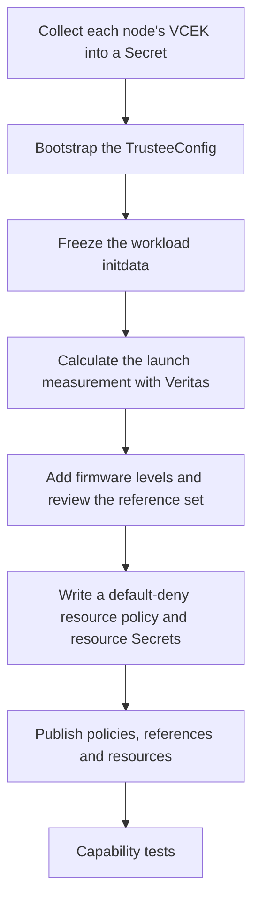

# Trustee setup

Trustee decides whether a confidential VM gets its secrets (see
[the attestation sequence](architecture.md#how-a-confidential-pod-gets-its-secrets)).
It needs three things: the AMD certificate (VCEK) of each approved node, the
measurements a correct VM must report (reference values), and policies that say
which resources a passing VM may receive.

On the test rig, one command does all of it: see [Disposable lab](#disposable-lab).
The rest of this page is the same sequence by hand, for a separate Trustee
cluster or a customer layout, which has not been validated on hardware.



## Disposable lab

The lab runs Trustee on the same cluster as the workloads, in the Permissive
profile over HTTP, with the restrictive resource policy enforcing. Install
[Podman](https://podman.io/) on the controller first (it runs Veritas). In a
terminal where you ran `source scripts/env.sh` after
[`make connect`](quickstart.md#5-install-the-coco-operators):

```bash
make trustee-lab
source scripts/env.sh
```

It takes about 3 minutes and runs these steps, naming each as it starts:

| Step | What it does |
|---|---|
| `vcek` | Collects this node's VCEK, so a certificate from an earlier rig is never used, and publishes it to Trustee |
| `bootstrap` | Creates the TrusteeConfig and the `coco-validation` namespace, and labels both namespaces `coco.openshift.io/disposable=true` |
| `mirror` | Copies the mirror registry's CA and password from the helper to `$COCO_STATE_DIR` |
| `initdata` | Writes the test workloads' initdata |
| `cmdline` | Starts a throwaway `kata-cc` pod and reads the VM's kernel command line on the node |
| `veritas` | Pulls Veritas with your pull secret and calculates the launch measurement |
| `references` | Adds the node's four firmware levels, prints every reference value and asks you to type `yes` |
| `images` | Builds and signs the [test images](capability-status.md#signed-images) on the helper |
| `configure` | Publishes the restrictive resource policy pinned in the release manifest, the references and the lab's synthetic resources (registry credential and configuration, image policies, signing key, a sample secret) |

Approve the reference values only if they are the firmware levels you accept for
this node. Without a terminal, approve ahead with `APPROVE_REFERENCES=1 make trustee-lab`.
The settings for the tests go to `$COCO_STATE_DIR/trustee-lab.env`, which
`source scripts/env.sh` loads. Then run the [capability tests](capability-status.md).

If a step fails, fix the cause and start again at that step, for example
`make trustee-lab FROM=veritas`; earlier steps' files are kept.

The `images` step prints two expected warnings: Cosign stores the registry login
unencrypted (in a working directory it then deletes), and it skips
transparency-log verification, because the offline lab has none. The signature
is still checked against the key. The signing key pair and its generated password
stay in `$COCO_STATE_DIR/rung-image-artifacts` and are reused on the next run; a
key pair from a manual build needs `COSIGN_PASSWORD` set.

## By hand

Customer defaults are **Restricted, HTTPS and a separate trust domain**. Use the
pinned `oc`, Python 3.12+ and `jq`, set `TRUSTEE_CONTEXT` explicitly, and keep
every generated file in `COCO_STATE_DIR`.

### Bootstrap

Install the Trustee Operator on the intended cluster. Provision these Secrets
through the customer's certificate process:

- `kbs-https-cert`: the endpoint TLS certificate and key (`tls.crt`, `tls.key`).
- `kbs-token-cert`: the attestation token signing certificate and key.

`TRUSTEE_HTTPS_SECRET` and `TRUSTEE_TOKEN_SECRET` override the names. Rerunning
bootstrap does not rotate them. Then collect each approved worker's VCEK and
publish it. The collector names each worker's directory after its HWID (the chip
ID, 128 lowercase hex digits), and bootstrap needs those IDs in `HWIDS`:

```bash
export TRUSTEE_CONTEXT=customer-trustee TRUSTEE_PROFILE=Restricted TRUSTEE_LAB=0 TEE=snp
make collect-vcek NODE='<worker-node>'   # uses WORKER_CONTEXT
make seed-vcek                           # uses TRUSTEE_CONTEXT
export HWIDS="$(ls "$COCO_STATE_DIR/vcek-bundle" | grep -E '^[0-9a-f]{128}$' | tr '\n' ' ')"
make preflight
scripts/apply-trustee.sh bootstrap
```

If the controller cannot reach AMD's key server, collection stops after recording
the certificate URL: run `scripts/collect-vcek.sh --download` on a connected
machine and copy the bundle back before `make seed-vcek`.

Bootstrap waits for the Operator-owned KbsConfig and ConfigMaps, checks their
ownership and selects the SNP `OfflineStore`. `RENDER_ONLY=1` shows the
TrusteeConfig without changing anything. An independent older KbsConfig stops it:
this is a fresh bootstrap, not a Trustee 1.1 upgrade (see
[customer planning](customer-planning.md)). Do not delete configuration or set
migration markers by hand to get past that check.

### Calculate the reference values

Freeze the exact workload initdata, including the complete reviewed agent policy.
For the test workloads, the renderer prints it (set the profile, CA and policy
variables you will test with):

```bash
EMIT_INITDATA=1 make -s run-rung-kbs > "$COCO_STATE_DIR/initdata.toml"
```

Read the VM's kernel command line from a running `kata-cc` pod (it does not need
to attest), not from the Kata configuration: the runtime adds parameters at launch.

```bash
oc --context="$WORKER_CONTEXT" debug node/'<worker-node>' -- chroot /host sh -c \
  'for p in $(pgrep -f qemu); do tr "\0" "\n" < /proc/$p/cmdline | grep -A1 -x -- -append | tail -n 1; done'
```

Then calculate the launch measurement (this can need connected registry access,
so do it before isolating the cluster) and build the reference set:

```bash
PULL_SECRET="$COCO_STATE_DIR/credentials/pull-secret.json" \
  INITDATA="$COCO_STATE_DIR/initdata.toml" \
  OUT="$COCO_STATE_DIR/rvps-generated.yaml" \
  VERITAS_KERNEL_CMDLINE='<the command line read above>' \
  scripts/gen-rvps-veritas.sh
scripts/review-references.py "$COCO_STATE_DIR/rvps-generated.yaml" \
  "$COCO_STATE_DIR/rvps-reviewed.yaml" --drop init_data
```

`review-references.py` adds the four firmware levels (`snp_bootloader`,
`snp_microcode`, `snp_snp_svn`, `snp_tee_svn`) for every HWID in `HWIDS` from the
VCEK request URLs, drops coco-tools' unused SHA-384 `init_data` record and prints
the set. Trustee 1.2 rejects malformed, duplicate or expired records. Generating a
value does not approve it: confirm its source, platform and expiry first.

### Bind initdata (optional)

The default CPU policy does not check the full initdata digest. For a deployment
that runs one fixed workload, render a policy that does, from the actual vendor
policy:

```bash
CPU_CM="$(oc --context="$TRUSTEE_CONTEXT" -n trustee-operator-system get kbsconfig \
  -o jsonpath='{.items[0].spec.kbsAttestationPolicyConfigMapName}')"
oc --context="$TRUSTEE_CONTEXT" -n trustee-operator-system get configmap "$CPU_CM" \
  -o jsonpath='{.data.default_cpu\.rego}' > "$COCO_STATE_DIR/default_cpu.rego"
BASE_CPU_POLICY_FILE="$COCO_STATE_DIR/default_cpu.rego" CPU_CONFIGMAP_NAME="$CPU_CM" \
  scripts/render-measurement-policy.sh "$COCO_STATE_DIR/initdata.toml" \
  > "$COCO_STATE_DIR/cpu-policy.yaml"
```

Review and apply it in the Trustee context, then refresh Trustee with
`scripts/refresh-trustee.py` ([maintenance](maintenance.md#configuration-refresh)).
Skip this before the capability tests: `rung-initdata` adds the same condition for
its own workload, restores the policy afterwards and refuses a policy that is
already bound.

### Publish the policy and resources

The resource policy must deny by default and require the hardware, executables
and configuration appraisals for every resource. The Operator's
[restrictive policy](https://github.com/openshift/trustee-operator/blob/v1.2.1/config/templates/resource-policy-restrictive.rego)
does that, and the lab enforces it. Its hardware appraisal needs the four firmware
records above.

```bash
curl -fsSL -o "$COCO_STATE_DIR/resource-policy.rego" \
  https://raw.githubusercontent.com/openshift/trustee-operator/v1.2.1/config/templates/resource-policy-restrictive.rego
```

Provision the workload's resource Secrets out of band; their names and keys
become `kbs:///default/<secret>/<key>` URIs. Then publish:

```bash
TRUSTEE_RESOURCE_POLICY_FILE="$COCO_STATE_DIR/resource-policy.rego" \
  TRUSTEE_RVPS_FILE="$COCO_STATE_DIR/rvps-reviewed.yaml" \
  KBS_RESOURCE_NAMES='credential sample security-policy registry-configuration' \
  scripts/apply-trustee.sh configure
```

The reference file **replaces the active set**, so include every record. Configure
keeps unrelated fields and resources, publishes policy and references before it
attaches resource names, and waits until new Trustee pods serve them (Trustee 1.2.1
ignores `oc rollout restart`). It checks structure and ownership; only the
[capability tests](capability-status.md) show enforcement.

Implementation references: [Operator ownership and migration](https://github.com/openshift/trustee-operator/tree/v1.2.1/internal/controller)
and the [reference-value format](https://github.com/openshift/trustee/blob/v1.2.1/rvps/src/reference_value.rs).
