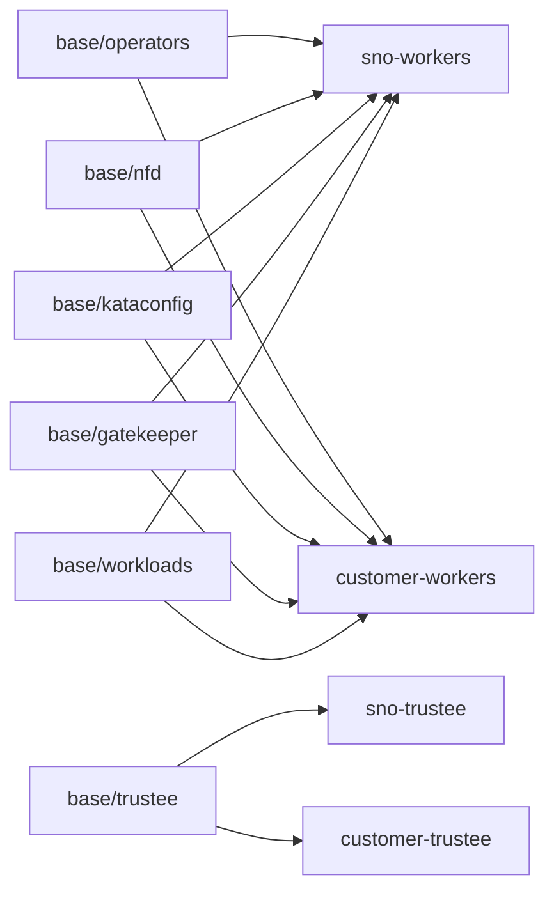

# GitOps manifests

Kustomize manifests for the Operators, the Kata runtime, the Gatekeeper memory
guard, Trustee and the test workloads. Versions come from
[the release manifest](../install/release-manifest.json).

Install with the staged scripts, not by applying an overlay directly:
`make install-coco-operators` for the worker side and
`scripts/apply-trustee.sh bootstrap|configure` for Trustee. They apply each piece
in order, wait for its CRDs and rollouts, and approve only InstallPlans that match
the manifest. `oc apply -k` on a whole overlay skips those checks and races CRDs
that do not exist yet. The `argocd.argoproj.io/sync-wave` annotations order the
same pieces for an Argo CD sync.

## Base components

| Directory | Contents | Sync wave |
|---|---|---|
| [`base/operators`](base/operators/README.md) | Namespaces, OperatorGroups and Manual Subscriptions for NFD, cert-manager, OSC and Trustee; disables the default public catalogs | 0 |
| `base/nfd` | NFD instance and a rule that labels SEV-SNP nodes `amd.feature.node.kubernetes.io/snp=true` | 1 |
| `base/kataconfig` | OSC feature gates and the KataConfig that installs the `kata-cc` runtime (reboots the node) | 2 |
| `base/gatekeeper` | Gatekeeper Subscription and instance, plus the CoCo memory guard: an Assign that fills a missing memory default and a constraint that rejects undersized confidential pods | 3 |
| `base/workloads` | The `rung-kbs` secret-release test pod; the signed and encrypted test pods are rendered by scripts | 6 |
| `base/trustee` | The Restricted (HTTPS) TrusteeConfig; [`secret-stubs.example.yaml`](base/trustee/secret-stubs.example.yaml) lists the Secrets it needs, without values | (separate) |
| `base/airgap-egress` | Optional MachineConfig that filters the node's outbound traffic; apply on its own after the cluster is healthy | (none) |

## Overlays



| Overlay | Intended scope |
|---|---|
| `sno-workers` | Disposable single-node worker stack; the staged install requires `INSTALL_TOPOLOGY=sno TRUSTEE_LAB=1` |
| `customer-workers` | Separate worker cluster: removes the Trustee Operator and limits Kata and the test pods to nodes labeled `node-role.kubernetes.io/coco-snp` |
| `sno-trustee`, `customer-trustee` | Restricted Trustee base; TLS certificates and resources are supplied out of band |

Co-located Permissive HTTP testing is selected through the scripts
(`TRUSTEE_PROFILE=Permissive TRUSTEE_LAB=1`), not by an overlay name. The customer
overlays are starting points and have not been validated on hardware; see
[validation results](../docs/validation.md). Inspect any overlay without applying it:

```bash
make render-overlay OVERLAY=customer-workers
```

## Inputs that are not in Git

VCEK certificates, reference values, initdata, endpoint certificates and policies
are specific to each site and workload. Recollect VCEKs for the actual workers,
recalculate launch references when the guest artifacts change, and follow
[Trustee setup](../docs/trustee.md) and [guest registry access](../docs/guest-images.md)
before launching workloads.
